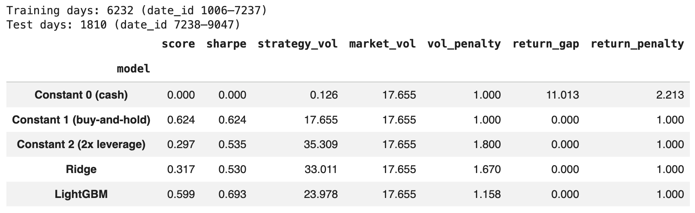

# GROUP59_CENG313 — Hull Tactical Market Prediction

Course project for **CENG313 – Introduction to Data Science**.

## Team

| Name | Student ID | GitHub |
|------|------------|--------|
| Sadık Onur Hayta | 23118080046 | [@onurhayta](https://github.com/onurhayta) |

- **Group ID:** 59
- **Competition level:** Light (1 student)
- **Modality:** Time series

## Competition

- **Kaggle competition:** [Hull Tactical – Market Prediction](https://www.kaggle.com/competitions/hull-tactical-market-prediction)
- **Task:** For each trading day, choose an allocation to the S&P 500 in the range **[0, 2]**
  (0 = fully in cash / risk-free asset, 1 = fully invested, 2 = 2x leveraged). The rest of the
  capital earns the risk-free rate.
- **Evaluation metric:** A modified (volatility-adjusted) Sharpe ratio. The score is penalised when
  the strategy's volatility exceeds **1.2×** the market's volatility, and when the strategy's return
  falls below the market's return. Re-implemented in `src/utils.py` and verified against the official
  scoring code (Kaggle metric `hull-competition-sharpe`): identical scores on 1,000 random test cases.
- **Competition format:** Code competition (predictions are served through Kaggle's evaluation API).
  Timeline: started 15 Sep 2025, final submission deadline 15 Dec 2025, ended 16 Jun 2026.

## Dataset

`train.csv` contains **9,048 trading days** (`date_id` 0–9047, ≈36 years) and **98 columns**:
`date_id`, 94 anonymised features and 3 target columns. Dates are anonymised, so `date_id` only gives the order of the days.

| Prefix | Feature group | # features |
|--------|---------------|-----------:|
| `M*`   | Market dynamics / technical | 18 |
| `E*`   | Macro-economic | 20 |
| `I*`   | Interest rates | 9 |
| `P*`   | Price / valuation | 13 |
| `V*`   | Volatility | 13 |
| `S*`   | Sentiment | 12 |
| `D*`   | Binary / dummy indicators | 9 |

Target columns:

- `forward_returns` – next-day S&P 500 return
- `risk_free_rate` – federal funds rate
- `market_forward_excess_returns` – forward return relative to expectations (demeaned with a long-term rolling average and clipped); used as the prediction target

`test.csv` has the same features plus lagged target columns and an `is_scored` flag.

> The data files are **not** stored in this repository (see `.gitignore`) because the competition rules do not allow redistributing the data.
> They are downloaded from Kaggle inside the notebook (see *How to run*).

## Repository structure

```
GROUP59_CENG313/
├── README.md
├── requirements.txt
├── assignment1_eda_baseline.ipynb   # Assignment 1: EDA + baseline models
├── assignment2_solution.ipynb       # Assignment 2: proposed solution (to be added)
├── src/
│   ├── __init__.py
│   ├── data.py      # loading, feature groups, duplicates/missing summaries, preprocessing, splits
│   ├── models.py    # model interface, constant / Ridge / LightGBM baselines, walk-forward evaluation
│   ├── plots.py     # plotting helpers used in the notebooks (EDA, folds, model results)
│   └── utils.py     # competition metric and evaluation helpers
├── data/                            # NOT committed (Kaggle rules + file size)
└── submissions/                     # score screenshots
```

## Approach

### Assignment 1 – EDA and baselines ✅

The notebook `assignment1_eda_baseline.ipynb` follows the required structure: 1 Problem definition, 2 Data overview, 3 EDA, 4 Preprocessing, 5 Baseline model, 6 Kaggle submission (held-out evaluation), 7 Conclusion.

**Data overview** (Section 2): all 94 features are numeric (`D*` as 0/1 integers, the rest as floats); there are no duplicated days or rows, but `D1` and `D2` are identical columns.

**Exploratory data analysis** (Section 3):

- **Missing values:** for the first 1,006 days only the 9 `D*` features exist; most other features start at day 1006 and some much later (e.g. `E7` ≈ day 6969). Missingness is structural, not random.
- **Target distribution:** daily mean 0.047% and std 1.05% (≈12% annual return, ≈17% annual volatility); fat tails (excess kurtosis ≈ 2.2), slight negative skew, clipped at about ±4%. Volatility varies between ≈9% and ≈34% per year.
- **Predictability:** returns have almost no autocorrelation, but absolute returns are strongly autocorrelated, i.e. **direction is hard to predict, volatility is predictable**.
- **Feature–target relationships:** all correlations are weak (|Spearman| ≤ 0.054), noisy and non-linear; many features are highly correlated with each other.
- **Stability:** the relationships change over time and nearly vanish in the most recent period (non-stationarity).

**Preprocessing** (Section 4): time order is kept (no shuffling), the first 1,006 rows are dropped, and missing values are kept and handled inside the models (median imputation + standardisation for Ridge, native handling in LightGBM), fitted on training rows only to avoid leakage. No encoding is needed. Implemented in `src.data.preprocess`.

**Validation:** expanding-window **walk-forward** validation on rows from `date_id` 1006 onwards, with 8 consecutive validation folds of 504 days (≈2 years) and a 1-day gap. Each fold is scored with the competition metric.

**Baselines** (`src/models.py`):

1. Constant allocation 0 (cash), 1 (buy-and-hold) and 2 (2× leverage)
2. Ridge regression (median imputation + standardisation, α = 100)
3. LightGBM

Ridge and LightGBM predict `market_forward_excess_returns`; the prediction is mapped to an allocation with
`clip(1 + 0.5 · prediction / std_train, 0, 2)`.

### Assignment 2 – Proposed solution *(planned)*

Based on the EDA: volatility-aware position sizing, a tuned prediction-to-allocation mapping, feature selection and engineering, handling non-stationarity (rolling vs. expanding windows) and ensembling. Compared against the Assignment 1 baselines on the same folds.

## Results

Walk-forward validation, 8 folds × 504 days (`date_id` 5016–9047):

| Model | Mean fold score | Std across folds | Full-period score | Folds beating buy-and-hold |
|-------|----------------:|-----------------:|------------------:|---------------------------:|
| Constant 1 (buy-and-hold) | **0.844** | 0.590 | **0.766** | – |
| LightGBM | 0.718 | 0.365 | 0.699 | 5 / 8 |
| Ridge | 0.519 | 0.343 | 0.520 | 2 / 8 |
| Constant 2 (2× leverage) | 0.431 | 0.322 | 0.381 | 1 / 8 |
| Constant 0 (cash) | 0.000 | 0.000 | 0.000 | 1 / 8 |

Buy-and-hold is not beaten overall. LightGBM is the strongest and most stable model; Ridge is penalised for exceeding the volatility limit (strategy volatility 23.6% vs. market 15.9%).

**Held-out test set** (last 20% of `train.csv`, `date_id` 7238–9047, 1,810 days; models trained on `date_id` 1006–7237):

| Model | Held-out score | Raw Sharpe | Strategy volatility | Volatility penalty |
|-------|---------------:|-----------:|--------------------:|-------------------:|
| Constant 1 (buy-and-hold) | **0.624** | 0.624 | 17.7% | 1.000 |
| LightGBM | 0.599 | **0.693** | 24.0% | 1.158 |
| Ridge | 0.317 | 0.530 | 33.0% | 1.670 |
| Constant 2 (2× leverage) | 0.297 | 0.535 | 35.3% | 1.800 |
| Constant 0 (cash) | 0.000 | 0.000 | 0.1% | 1.000 |

LightGBM has a higher raw Sharpe ratio than buy-and-hold, but takes more risk than the 1.2× limit allows and falls just below the market after the volatility penalty.

## How to run

The notebooks are designed for **Google Colab**.

1. Join the competition on Kaggle and accept the [competition rules](https://www.kaggle.com/competitions/hull-tactical-market-prediction/rules) (required to download the data).
2. Create a Kaggle API token (*Kaggle → Settings → API Tokens → Generate*).
3. Open the notebook in Colab (use the *Open in Colab* badge at the top of the notebook, or *File → Open notebook → GitHub*).
4. In Colab, open **Secrets** (key icon on the left), add a secret named `KAGGLE_API_TOKEN` with your token, and enable notebook access.
5. Run all cells. The setup cells clone this repository (so that `src/` can be imported) and download the data with `kagglehub`.

Locally:

```bash
git clone https://github.com/onurhayta/group59_CENG313.git
cd group59_CENG313
pip install -r requirements.txt kagglehub
export KAGGLE_API_TOKEN=<your token>
jupyter notebook assignment1_eda_baseline.ipynb
```

## Progress log

| Date | Work done |
|------|-----------|
| 2026-10-29 | Repository created; README, `.gitignore`, `requirements.txt`, `src` package and `src/data.py` (data loading, feature groups, walk-forward splits) added. |
| 2026-11-05 | Competition metric (`src/utils.py`) and baseline models (`src/models.py`) added. Assignment 1 notebook: data download, EDA (missing values, target distribution, volatility, feature–target relationships, stability), walk-forward validation and baseline results. README updated with results. |
| 2026-11-07 | Competition metric verified against the official Kaggle scoring code (identical scores on 1,000 random cases) and zero-volatility handling aligned with it; plotting code moved from the notebook into reusable functions in `src/plots.py` and the notebook updated to use them. |
| 2026-11-11 | Repository renamed to `GROUP59_CENG313`; preprocessing, duplicate check and hold-out split helpers added to `src/data.py`; notebook restructured into the required sections (problem definition, data overview with dtypes and duplicates, preprocessing, held-out evaluation, conclusion) and re-run from scratch; held-out evaluation on the last 20% of the data added, with a score screenshot in `submissions/`; README updated. |

## Kaggle score

**Competition closed — evaluated on a held-out split.**

The competition no longer accepts late submissions (the *Late Submission* button is disabled), so, following the course instructions, the last 20% of `train.csv` is used as a test set. Because the data is a time series, the split is chronological (`train_test_split(..., test_size=0.2, shuffle=False)`) instead of random, to avoid look-ahead leakage.

| Date | Model | Held-out score | Proof |
|------|-------|---------------:|-------|
| 2026-11-11 | Constant 1 (buy-and-hold) | 0.624 | [`submissions/assignment1_holdout_score.png`](submissions/assignment1_holdout_score.png) |
| 2026-11-11 | LightGBM (best model) | 0.599 | [`submissions/assignment1_holdout_score.png`](submissions/assignment1_holdout_score.png) |



For comparison, a bronze-medal solution on the final private leaderboard (rank 366 of 3,677 teams) scored 1.70 ([source](https://github.com/datahubber/hull-tactical-market-timing)); our baselines are clearly below that level. The top public-leaderboard scores (≈17.5) are far above any realistic Sharpe ratio and are not a meaningful benchmark.